# Cơ sở dữ liệu hiện hành — 24 bảng nghiệp vụ

Cập nhật 20/10/2026. Danh sách cột, PK/FK, UNIQUE và index dưới đây đối chiếu trực tiếp với [V1](../src/main/resources/db/migration/V1__khoi_tao_24_bang.sql). [V2](../src/main/resources/db/migration/V2__bo_sung_truong_bo_mon.sql) chỉ bổ sung TRUONG_BO_MON vào CHECK vai trò, không thêm bảng/cột.

## 1. Quy ước và nguồn chuẩn

- Local: MySQL 8.0.46; online Aiven đã ghi nhận MySQL 8.4.11. Engine InnoDB, utf8mb4; giữ strict mode và FK.
- Có 24 bảng nghiệp vụ, cộng flyway_schema_history do Flyway quản lý. Không có bảng hàng đợi email, audit log hoặc trigger nghiệp vụ.
- SQL snake_case; Java camelCase, entity ID hiện dùng Integer. INT UNSIGNED ở SQL có dải lớn hơn Integer; không suy ra code hỗ trợ mọi giá trị unsigned.
- DATETIME(6) lưu UTC; form/DTO chuyển giờ Việt Nam. DATE ngày hội đồng là ngày địa phương. Điểm DECIMAL/BigDecimal.
- PK: khóa chính; FK: khóa ngoại; AI: auto increment; GENERATED: cột DB tính, không nhập từ form, mapping JPA không ghi trực tiếp.
- NULL là không có/không áp dụng, không dùng điểm 0 thay cho chưa chấm. Cột GENERATED có thể trả NULL để UNIQUE cho phép nhiều bản ghi không thuộc trạng thái đang hoạt động.
- Các FK nghiệp vụ hiện dùng ON DELETE RESTRICT và ON UPDATE RESTRICT. Không tự thêm cascade remove để xóa dữ liệu đã sử dụng.
- Nghiệp vụ liên bảng (số người, người được chấm, thời gian, chủ nhóm) nằm ở Service. DB bảo vệ FK/UNIQUE/CHECK nhưng không tự thực hiện toàn quy trình.
- Schema mới do Flyway tạo; không chạy lại SQL khởi tạo vào DB đang dùng. Không sửa V1/V2 đã phát hành.

## 2. Bảng và vai trò

| STT | Bảng | Mục đích |
|---|---|---|
| 1 | `bo_mon` | Bộ môn |
| 2 | `tai_khoan` | Tài khoản |
| 3 | `tai_khoan_vai_tro` | Vai trò của tài khoản |
| 4 | `sinh_vien` | Hồ sơ sinh viên |
| 5 | `giang_vien` | Hồ sơ giảng viên |
| 6 | `dot_dang_ky` | Đợt đăng ký |
| 7 | `de_tai` | Đề tài trong một đợt |
| 8 | `huong_dan` | Phân công hướng dẫn |
| 9 | `nhom` | Nhóm sinh viên |
| 10 | `thanh_vien_nhom` | Thành viên chính thức |
| 11 | `loi_moi_nhom` | Lời mời vào nhóm |
| 12 | `dang_ky` | Đăng ký hiện hành và giữ chỗ |
| 13 | `bao_cao` | Phiên bản bộ báo cáo |
| 14 | `bao_cao_tep` | Ba tài liệu của một bộ báo cáo |
| 15 | `hoi_dong` | Hội đồng theo đợt |
| 16 | `thanh_vien_hoi_dong` | Thành phần hội đồng |
| 17 | `danh_gia` | Một lần đánh giá, gộp phản biện và hội đồng |
| 18 | `phan_cong_cham` | Mỗi GV một phân công trong lần đánh giá |
| 19 | `phieu_cham` | Phiên bản điểm và nhận xét |
| 20 | `yeu_cau_sua_diem` | Xin và duyệt điều chỉnh điểm |
| 21 | `ket_qua` | Phiên bản kết quả tổng hợp/công bố |
| 22 | `chi_tiet_ket_qua` | Phiếu nguồn của từng snapshot |
| 23 | `thong_bao` | Thông báo cho người đăng nhập |
| 24 | `thong_bao_tep` | Tệp của thông báo |

## 3. ERD tổng quan

Sơ đồ bao phủ 24 bảng và các quan hệ FK; khóa/quan hệ nhiều cột được mô tả chính xác ở mục 5. Các nhánh tham chiếu người tạo/duyệt cũng là FK tài khoản. Khi xuất Word có thể chia hình theo phân hệ để chữ đọc được.

```mermaid
erDiagram
    bo_mon {
        INT id PK
    }
    tai_khoan {
        INT id PK
    }
    tai_khoan_vai_tro {
        INT tai_khoan_id PK,FK
        VARCHAR(32) vai_tro PK
    }
    sinh_vien {
        INT id PK
        INT tai_khoan_id FK
    }
    giang_vien {
        INT id PK
        INT tai_khoan_id FK
        INT bo_mon_id FK
    }
    dot_dang_ky {
        INT id PK
        INT nguoi_tao_id FK
    }
    de_tai {
        INT id PK
        INT dot_id FK
        INT bo_mon_id FK
        INT gv_de_xuat_id FK
        INT nguoi_duyet_id FK
        INT nguoi_cong_bo_id FK
    }
    huong_dan {
        INT de_tai_id PK,FK
        INT giang_vien_id PK,FK
        INT nguoi_phan_cong_id FK
    }
    nhom {
        INT id PK
        INT dot_id FK
        INT nguoi_tao_id FK
    }
    thanh_vien_nhom {
        INT nhom_id PK,FK
        INT sinh_vien_id PK,FK
        INT dot_id FK
    }
    loi_moi_nhom {
        INT id PK
        INT nhom_id FK
        INT sinh_vien_duoc_moi_id FK
        INT nguoi_moi_id FK
    }
    dang_ky {
        INT id PK
        INT nhom_id FK
        INT de_tai_id FK
        INT dot_id FK
        INT nguoi_dang_ky_id FK
        INT nguoi_duyet_id FK
    }
    bao_cao {
        INT id PK
        INT dang_ky_id FK
        INT nguoi_tao_id FK
        INT nguoi_nop_id FK
    }
    bao_cao_tep {
        INT id PK
        INT bao_cao_id FK
        INT nguoi_tai_len_id FK
    }
    hoi_dong {
        INT id PK
        INT dot_id FK
        INT nguoi_tao_id FK
    }
    thanh_vien_hoi_dong {
        INT hoi_dong_id PK,FK
        INT giang_vien_id PK,FK
    }
    danh_gia {
        INT id PK
        INT dang_ky_id FK
        INT dot_id FK
        INT bao_cao_chot_id FK
        INT hoi_dong_id FK
        INT nguoi_tao_id FK
    }
    phan_cong_cham {
        INT id PK
        INT danh_gia_id FK
        INT giang_vien_id FK
        INT nguoi_phan_cong_id FK
    }
    phieu_cham {
        INT id PK
        INT phan_cong_cham_id FK
        INT nguoi_tao_id FK
        INT yeu_cau_sua_diem_id FK
    }
    yeu_cau_sua_diem {
        INT id PK
        INT phan_cong_cham_id FK
        INT phieu_cham_goc_id FK
        INT nguoi_yeu_cau_id FK
        INT nguoi_duyet_id FK
    }
    ket_qua {
        INT id PK
        INT danh_gia_id FK
        INT nguoi_tong_hop_id FK
        INT nguoi_xac_nhan_id FK
        INT nguoi_cong_bo_id FK
    }
    chi_tiet_ket_qua {
        INT ket_qua_id PK,FK
        INT phan_cong_cham_id PK,FK
        INT danh_gia_id FK
        INT phieu_cham_id FK
    }
    thong_bao {
        INT id PK
        INT nguoi_dang_id FK
    }
    thong_bao_tep {
        INT id PK
        INT thong_bao_id FK
        INT nguoi_tai_len_id FK
    }
    tai_khoan ||--o{ tai_khoan_vai_tro : "tai_khoan_id"
    tai_khoan ||--o| sinh_vien : "tai_khoan_id"
    tai_khoan ||--o| giang_vien : "tai_khoan_id"
    bo_mon ||--o{ giang_vien : "bo_mon_id"
    tai_khoan ||--o{ dot_dang_ky : "nguoi_tao_id"
    dot_dang_ky ||--o{ de_tai : "dot_id"
    bo_mon ||--o{ de_tai : "bo_mon_id"
    giang_vien ||--o{ de_tai : "gv_de_xuat_id"
    tai_khoan |o--o{ de_tai : "nguoi_duyet_id"
    tai_khoan |o--o{ de_tai : "nguoi_cong_bo_id"
    de_tai ||--o{ huong_dan : "de_tai_id"
    giang_vien ||--o{ huong_dan : "giang_vien_id"
    tai_khoan ||--o{ huong_dan : "nguoi_phan_cong_id"
    dot_dang_ky ||--o{ nhom : "dot_id"
    sinh_vien ||--o{ nhom : "nguoi_tao_id"
    nhom ||--o{ thanh_vien_nhom : "nhom_id_dot_id"
    sinh_vien ||--o{ thanh_vien_nhom : "sinh_vien_id"
    nhom ||--o{ loi_moi_nhom : "nhom_id"
    sinh_vien ||--o{ loi_moi_nhom : "sinh_vien_duoc_moi_id"
    sinh_vien ||--o{ loi_moi_nhom : "nguoi_moi_id"
    nhom ||--o{ dang_ky : "nhom_id_dot_id"
    de_tai ||--o{ dang_ky : "de_tai_id_dot_id"
    sinh_vien ||--o{ dang_ky : "nguoi_dang_ky_id"
    tai_khoan |o--o{ dang_ky : "nguoi_duyet_id"
    dang_ky ||--o{ bao_cao : "dang_ky_id"
    sinh_vien ||--o{ bao_cao : "nguoi_tao_id"
    sinh_vien |o--o{ bao_cao : "nguoi_nop_id"
    bao_cao ||--o{ bao_cao_tep : "bao_cao_id"
    tai_khoan ||--o{ bao_cao_tep : "nguoi_tai_len_id"
    dot_dang_ky ||--o{ hoi_dong : "dot_id"
    tai_khoan ||--o{ hoi_dong : "nguoi_tao_id"
    hoi_dong ||--o{ thanh_vien_hoi_dong : "hoi_dong_id"
    giang_vien ||--o{ thanh_vien_hoi_dong : "giang_vien_id"
    dang_ky ||--o{ danh_gia : "dang_ky_id_dot_id"
    bao_cao |o--o{ danh_gia : "bao_cao_chot_id_dang_ky_id"
    hoi_dong |o--o{ danh_gia : "hoi_dong_id_dot_id"
    tai_khoan ||--o{ danh_gia : "nguoi_tao_id"
    danh_gia ||--o{ phan_cong_cham : "danh_gia_id"
    giang_vien ||--o{ phan_cong_cham : "giang_vien_id"
    tai_khoan ||--o{ phan_cong_cham : "nguoi_phan_cong_id"
    phan_cong_cham ||--o{ phieu_cham : "phan_cong_cham_id"
    tai_khoan ||--o{ phieu_cham : "nguoi_tao_id"
    yeu_cau_sua_diem |o--o| phieu_cham : "yeu_cau_sua_diem_id_phan_cong_cham_id"
    phan_cong_cham ||--o{ yeu_cau_sua_diem : "phan_cong_cham_id"
    phieu_cham ||--o{ yeu_cau_sua_diem : "phieu_cham_goc_id_phan_cong_cham_id"
    tai_khoan ||--o{ yeu_cau_sua_diem : "nguoi_yeu_cau_id"
    tai_khoan |o--o{ yeu_cau_sua_diem : "nguoi_duyet_id"
    danh_gia ||--o{ ket_qua : "danh_gia_id"
    tai_khoan ||--o{ ket_qua : "nguoi_tong_hop_id"
    tai_khoan |o--o{ ket_qua : "nguoi_xac_nhan_id"
    tai_khoan |o--o{ ket_qua : "nguoi_cong_bo_id"
    ket_qua ||--o{ chi_tiet_ket_qua : "ket_qua_id_danh_gia_id"
    phan_cong_cham ||--o{ chi_tiet_ket_qua : "phan_cong_cham_id_danh_gia_id"
    phieu_cham ||--o{ chi_tiet_ket_qua : "phieu_cham_id_phan_cong_cham_id"
    tai_khoan ||--o{ thong_bao : "nguoi_dang_id"
    thong_bao ||--o{ thong_bao_tep : "thong_bao_id"
    tai_khoan ||--o{ thong_bao_tep : "nguoi_tai_len_id"
```

## 4. Ràng buộc nghiệp vụ quan trọng

| Quy tắc | DB bảo vệ | Service bổ sung |
|---|---|---|
| Một SV một nhóm trong một đợt | UNIQUE sinh_vien_id + dot_id trong thanh_vien_nhom | Kiểm tra hồ sơ/vai trò, lời mời và transaction |
| Một trưởng nhóm | Cột generated co_truong_nhom và UNIQUE trong nhóm bảo vệ tối đa một | Bảo đảm luôn có đúng một trưởng khi thao tác hợp lệ |
| Một đề tài một nhóm giữ chỗ | co_giu_cho generated và UNIQUE de_tai_id + co_giu_cho | CHO_DUYET/CHAP_THUAN giữ chỗ; đổi đề tài nguyên tử, khóa đồng bộ |
| Một nhóm một đăng ký hiện hành | UNIQUE nhom_id trong dang_ky | Chuyển trạng thái trên dòng hiện hành, không tạo lịch sử bằng nhiều đăng ký |
| Một bộ ba tệp theo phiên bản | UNIQUE bao_cao(dang_ky_id,phien_ban), UNIQUE bao_cao_tep(bao_cao_id,loai_tai_lieu) | Đủ PDF/slide/source, đúng người nộp, trước hạn, loại/dung lượng hợp lệ |
| GV không có hai điểm do kiêm nhiệm | UNIQUE danh_gia_id + giang_vien_id trong phan_cong_cham | Gộp tư cách PB/hội đồng, lấy phiếu chính thức mới nhất |
| Điểm và trạng thái | CHECK điểm 0–10, version >0, cặp người/thời gian phù hợp | Nháp/nộp, thứ tự PB–hội đồng, xin sửa, tổng hợp và quyền bản ghi |
| Hội đồng 3–5, một chủ tịch/thư ký | UNIQUE vai trò độc quyền generated bảo vệ tối đa một mỗi chức danh | Số thành viên, đúng một mỗi vai trò, GVHD không chấm, đúng đợt/lịch |
| Đợt hai giai đoạn | CHECK thời gian và trường chỉ áp dụng theo loại | Thao tác theo Clock, trạng thái đợt, lịch thực hiện/đánh giá |
| Kết quả công bố bất biến | Phiên bản, snapshot chi_tiet_ket_qua và FK | Không sửa đè; sửa điểm tạo phiên bản và công bố lại |

Định nghĩa CHECK đầy đủ nằm trong V1; CHECK vai trò cuối cùng theo V2. Cảnh báo chuỗi rỗng không tương đương NULL: phần hội đồng không áp dụng của MON_HOC/TLCN được Service chuẩn hóa thành NULL để đáp ứng ck_danh_gia_khong_hd.

## 5. Từ điển từng bảng

### 1. bo_mon — Bộ môn

| Cột | Kiểu SQL | NULL | Khóa/kỹ thuật | DEFAULT | Ý nghĩa |
|---|---|---|---|---|---|
| id | INT UNSIGNED | Không | PK,AI | — | Khóa chính tự tăng. |
| ma_bo_mon | VARCHAR(20) | Không | — | — | Mã bộ môn. |
| ten_bo_mon | VARCHAR(150) | Không | — | — | Tên bộ môn. |
| dang_hoat_dong | TINYINT UNSIGNED | Không | — | 1 | 1: hoạt động; 0: ngừng hoạt động. |

**PK:** `id`.

**UNIQUE:**

- `uq_bo_mon_ma` (`ma_bo_mon`).

### 2. tai_khoan — Tài khoản

| Cột | Kiểu SQL | NULL | Khóa/kỹ thuật | DEFAULT | Ý nghĩa |
|---|---|---|---|---|---|
| id | INT UNSIGNED | Không | PK,AI | — | Khóa chính tự tăng. |
| ten_dang_nhap | VARCHAR(50) | Không | — | — | Tên đăng nhập; backend chuẩn hóa chữ thường. |
| mat_khau_bam | VARCHAR(255) | Không | — | — | Hash mật khẩu, không lưu plaintext. |
| ho_ten | VARCHAR(150) | Không | — | — | Họ tên. |
| email | VARCHAR(254) | Không | — | — | Email được chuẩn hóa nhất quán. |
| trang_thai | VARCHAR(32) | Không | — | 'HOAT_DONG' | Giá trị: HOAT_DONG, BI_KHOA. |
| tao_luc | DATETIME(6) | Không | — | CURRENT_TIMESTAMP(6) | Thời điểm tạo UTC. |
| cap_nhat_luc | DATETIME(6) | Không | — | CURRENT_TIMESTAMP(6) | Thời điểm cập nhật UTC. |

**PK:** `id`.

**UNIQUE:**

- `uq_tai_khoan_login` (`ten_dang_nhap`).
- `uq_tai_khoan_email` (`email`).

### 3. tai_khoan_vai_tro — Vai trò của tài khoản

| Cột | Kiểu SQL | NULL | Khóa/kỹ thuật | DEFAULT | Ý nghĩa |
|---|---|---|---|---|---|
| tai_khoan_id | INT UNSIGNED | Không | PK,FK | — | Tài khoản được cấp quyền. |
| vai_tro | VARCHAR(32) | Không | PK | — | Giá trị: ADMIN, TRUONG_KHOA, CAN_BO_KHOA, GIANG_VIEN, SINH_VIEN. |

**PK:** `tai_khoan_id`, `vai_tro`.

**FK** — tất cả RESTRICT khi DELETE/UPDATE:

- `fk_tai_khoan_vai_tro_tai_khoan`: (`tai_khoan_id`) → `tai_khoan` (`id`).

**Index phụ trợ:**

- `ix_tai_khoan_vai_tro_vai_tro` (`vai_tro`, `tai_khoan_id`).

**Sau V2:** vai_tro nhận ADMIN, TRUONG_KHOA, CAN_BO_KHOA, TRUONG_BO_MON, GIANG_VIEN, SINH_VIEN. Mô tả cột từ V1 chưa liệt kê giá trị thêm sau này.

### 4. sinh_vien — Hồ sơ sinh viên

| Cột | Kiểu SQL | NULL | Khóa/kỹ thuật | DEFAULT | Ý nghĩa |
|---|---|---|---|---|---|
| id | INT UNSIGNED | Không | PK,AI | — | Khóa chính tự tăng. |
| tai_khoan_id | INT UNSIGNED | Không | FK | — | Tài khoản của SV. |
| ma_sv | VARCHAR(20) | Không | — | — | Mã sinh viên. |
| lop | VARCHAR(30) | Có | — | NULL | Lớp hành chính, không phải lớp học phần. |
| khoa_hoc | VARCHAR(30) | Có | — | NULL | Khóa học. |

**PK:** `id`.

**FK** — tất cả RESTRICT khi DELETE/UPDATE:

- `fk_sinh_vien_tai_khoan`: (`tai_khoan_id`) → `tai_khoan` (`id`).

**UNIQUE:**

- `uq_sinh_vien_tai_khoan` (`tai_khoan_id`).
- `uq_sinh_vien_ma` (`ma_sv`).

### 5. giang_vien — Hồ sơ giảng viên

| Cột | Kiểu SQL | NULL | Khóa/kỹ thuật | DEFAULT | Ý nghĩa |
|---|---|---|---|---|---|
| id | INT UNSIGNED | Không | PK,AI | — | Khóa chính tự tăng. |
| tai_khoan_id | INT UNSIGNED | Không | FK | — | Tài khoản của GV. |
| ma_gv | VARCHAR(20) | Không | — | — | Mã giảng viên. |
| bo_mon_id | INT UNSIGNED | Không | FK | — | Bộ môn công tác. |
| hoc_vi | VARCHAR(50) | Có | — | NULL | Học vị. |

**PK:** `id`.

**FK** — tất cả RESTRICT khi DELETE/UPDATE:

- `fk_giang_vien_tai_khoan`: (`tai_khoan_id`) → `tai_khoan` (`id`).
- `fk_giang_vien_bo_mon`: (`bo_mon_id`) → `bo_mon` (`id`).

**UNIQUE:**

- `uq_giang_vien_tai_khoan` (`tai_khoan_id`).
- `uq_giang_vien_ma` (`ma_gv`).

**Index phụ trợ:**

- `ix_giang_vien_fk_bo_mon` (`bo_mon_id`).

### 6. dot_dang_ky — Đợt đăng ký

| Cột | Kiểu SQL | NULL | Khóa/kỹ thuật | DEFAULT | Ý nghĩa |
|---|---|---|---|---|---|
| id | INT UNSIGNED | Không | PK,AI | — | Khóa chính tự tăng. |
| ma_dot | VARCHAR(30) | Không | — | — | Mã đợt. |
| ten_dot | VARCHAR(200) | Không | — | — | Tên đợt. |
| loai | VARCHAR(32) | Không | — | — | Giá trị: MON_HOC, NCKH, TLCN, KLTN. |
| gv_bat_dau | DATETIME(6) | Không | — | — | Mở đề xuất của GV. |
| gv_ket_thuc | DATETIME(6) | Không | — | — | Đóng đề xuất của GV. |
| sv_bat_dau | DATETIME(6) | Không | — | — | Mở đăng ký của SV. |
| sv_ket_thuc | DATETIME(6) | Không | — | — | Đóng đăng ký của SV. |
| han_nop_bao_cao | DATETIME(6) | Không | — | — | Hạn nộp báo cáo. |
| han_nop_diem_pb | DATETIME(6) | Có | — | NULL | Hạn phản biện cấp đợt, chỉ TLCN/KLTN. |
| ngay_bao_cao_hd | DATE | Có | — | NULL | Ngày địa phương của hội đồng KLTN. |
| trang_thai | VARCHAR(32) | Không | — | 'NHAP' | Giá trị: NHAP, TRIEN_KHAI, KET_THUC, HUY. |
| nguoi_tao_id | INT UNSIGNED | Không | FK | — | Tài khoản trưởng khoa tạo đợt. |
| tao_luc | DATETIME(6) | Không | — | CURRENT_TIMESTAMP(6) | Thời điểm tạo. |

**PK:** `id`.

**FK** — tất cả RESTRICT khi DELETE/UPDATE:

- `fk_dot_dang_ky_nguoi_tao`: (`nguoi_tao_id`) → `tai_khoan` (`id`).

**UNIQUE:**

- `uq_dot_dang_ky_ma` (`ma_dot`).

**Index phụ trợ:**

- `ix_dot_dang_ky_loai_tt` (`loai`, `trang_thai`).
- `ix_dot_dang_ky_fk_nguoi_tao` (`nguoi_tao_id`).

### 7. de_tai — Đề tài trong một đợt

| Cột | Kiểu SQL | NULL | Khóa/kỹ thuật | DEFAULT | Ý nghĩa |
|---|---|---|---|---|---|
| id | INT UNSIGNED | Không | PK,AI | — | Khóa chính tự tăng. |
| dot_id | INT UNSIGNED | Không | FK | — | Đợt của đề tài. |
| bo_mon_id | INT UNSIGNED | Không | FK | — | Bộ môn quản lý. |
| ma_de_tai | VARCHAR(30) | Không | — | — | Mã đề tài. |
| ten_de_tai | VARCHAR(255) | Không | — | — | Tên đề tài. |
| noi_dung | TEXT | Không | — | — | Nội dung đề tài. |
| yeu_cau | TEXT | Có | — | NULL | Yêu cầu thực hiện. |
| san_pham_du_kien | TEXT | Có | — | NULL | Sản phẩm dự kiến. |
| gv_de_xuat_id | INT UNSIGNED | Không | FK | — | GV đề xuất, không mặc nhiên là GVHD. |
| trang_thai | VARCHAR(32) | Không | — | 'NHAP' | Giá trị: NHAP, CHO_DUYET, TU_CHOI, DA_DUYET, DA_CONG_BO. |
| nguoi_duyet_id | INT UNSIGNED | Có | FK | NULL | Tài khoản duyệt. |
| duyet_luc | DATETIME(6) | Có | — | NULL | Thời điểm duyệt. |
| nhan_xet_duyet | TEXT | Có | — | NULL | Nhận xét duyệt. |
| nguoi_cong_bo_id | INT UNSIGNED | Có | FK | NULL | Tài khoản công bố. |
| cong_bo_luc | DATETIME(6) | Có | — | NULL | Thời điểm công bố. |
| tao_luc | DATETIME(6) | Không | — | CURRENT_TIMESTAMP(6) | Thời điểm tạo. |

**PK:** `id`.

**FK** — tất cả RESTRICT khi DELETE/UPDATE:

- `fk_de_tai_dot_id`: (`dot_id`) → `dot_dang_ky` (`id`).
- `fk_de_tai_bo_mon_id`: (`bo_mon_id`) → `bo_mon` (`id`).
- `fk_de_tai_gv_de_xuat_id`: (`gv_de_xuat_id`) → `giang_vien` (`id`).
- `fk_de_tai_nguoi_duyet_id`: (`nguoi_duyet_id`) → `tai_khoan` (`id`).
- `fk_de_tai_nguoi_cong_bo_id`: (`nguoi_cong_bo_id`) → `tai_khoan` (`id`).

**UNIQUE:**

- `uq_de_tai_ma` (`ma_de_tai`).
- `uq_de_tai_id_dot` (`id`, `dot_id`).

**Index phụ trợ:**

- `ix_de_tai_dot_tt_bm` (`dot_id`, `trang_thai`, `bo_mon_id`).
- `ix_de_tai_gv_dot` (`gv_de_xuat_id`, `dot_id`).
- `ix_de_tai_fk_bo_mon_id` (`bo_mon_id`).
- `ix_de_tai_fk_nguoi_duyet_id` (`nguoi_duyet_id`).
- `ix_de_tai_fk_nguoi_cong_bo_id` (`nguoi_cong_bo_id`).

### 8. huong_dan — Phân công hướng dẫn

| Cột | Kiểu SQL | NULL | Khóa/kỹ thuật | DEFAULT | Ý nghĩa |
|---|---|---|---|---|---|
| de_tai_id | INT UNSIGNED | Không | PK,FK | — | Đề tài. |
| giang_vien_id | INT UNSIGNED | Không | PK,FK | — | GVHD. |
| nguoi_phan_cong_id | INT UNSIGNED | Không | FK | — | Tài khoản phân công. |
| phan_cong_luc | DATETIME(6) | Không | — | CURRENT_TIMESTAMP(6) | Thời điểm phân công. |

**PK:** `de_tai_id`, `giang_vien_id`.

**FK** — tất cả RESTRICT khi DELETE/UPDATE:

- `fk_huong_dan_de_tai`: (`de_tai_id`) → `de_tai` (`id`).
- `fk_huong_dan_gv`: (`giang_vien_id`) → `giang_vien` (`id`).
- `fk_huong_dan_nguoi_pc`: (`nguoi_phan_cong_id`) → `tai_khoan` (`id`).

**Index phụ trợ:**

- `ix_huong_dan_gv_dt` (`giang_vien_id`, `de_tai_id`).
- `ix_huong_dan_fk_nguoi_pc` (`nguoi_phan_cong_id`).

### 9. nhom — Nhóm sinh viên

| Cột | Kiểu SQL | NULL | Khóa/kỹ thuật | DEFAULT | Ý nghĩa |
|---|---|---|---|---|---|
| id | INT UNSIGNED | Không | PK,AI | — | Khóa chính tự tăng. |
| dot_id | INT UNSIGNED | Không | FK | — | Đợt của nhóm. |
| ma_nhom | VARCHAR(30) | Không | — | — | Mã nhóm trong đợt. |
| ten_nhom | VARCHAR(150) | Có | — | NULL | Tên nhóm. |
| trang_thai | VARCHAR(32) | Không | — | 'DANG_LAP' | Giá trị: DANG_LAP, DA_CHOT, DANG_THUC_HIEN, HOAN_THANH, GIAI_THE. |
| nguoi_tao_id | INT UNSIGNED | Không | FK | — | SV tạo nhóm và làm trưởng nhóm ban đầu. |
| tao_luc | DATETIME(6) | Không | — | CURRENT_TIMESTAMP(6) | Thời điểm tạo. |

**PK:** `id`.

**FK** — tất cả RESTRICT khi DELETE/UPDATE:

- `fk_nhom_dot`: (`dot_id`) → `dot_dang_ky` (`id`).
- `fk_nhom_nguoi_tao`: (`nguoi_tao_id`) → `sinh_vien` (`id`).

**UNIQUE:**

- `uq_nhom_dot_ma` (`dot_id`, `ma_nhom`).
- `uq_nhom_id_dot` (`id`, `dot_id`).

**Index phụ trợ:**

- `ix_nhom_dot_tt` (`dot_id`, `trang_thai`).
- `ix_nhom_fk_nguoi_tao` (`nguoi_tao_id`).

### 10. thanh_vien_nhom — Thành viên chính thức

| Cột | Kiểu SQL | NULL | Khóa/kỹ thuật | DEFAULT | Ý nghĩa |
|---|---|---|---|---|---|
| nhom_id | INT UNSIGNED | Không | PK,FK | — | Nhóm. |
| sinh_vien_id | INT UNSIGNED | Không | PK,FK | — | Sinh viên. |
| dot_id | INT UNSIGNED | Không | FK | — | Đợt, nhất quán với nhóm qua FK kép. |
| la_nhom_truong | TINYINT UNSIGNED | Không | — | 0 | 1 nếu là nhóm trưởng. |
| tham_gia_luc | DATETIME(6) | Không | — | CURRENT_TIMESTAMP(6) | Thời điểm trở thành thành viên. |
| co_truong_nhom | TINYINT UNSIGNED | Có | GENERATED | — | Cột kỹ thuật bảo vệ tối đa một trưởng nhóm. |

**PK:** `nhom_id`, `sinh_vien_id`.

**FK** — tất cả RESTRICT khi DELETE/UPDATE:

- `fk_thanh_vien_nhom_nhom_dot`: (`nhom_id`, `dot_id`) → `nhom` (`id`, `dot_id`).
- `fk_thanh_vien_nhom_sv`: (`sinh_vien_id`) → `sinh_vien` (`id`).

**UNIQUE:**

- `uq_thanh_vien_nhom_sv_dot` (`sinh_vien_id`, `dot_id`).
- `uq_thanh_vien_nhom_truong` (`nhom_id`, `co_truong_nhom`).

**Index phụ trợ:**

- `ix_thanh_vien_nhom_fk_nhom_dot` (`nhom_id`, `dot_id`).

### 11. loi_moi_nhom — Lời mời vào nhóm

| Cột | Kiểu SQL | NULL | Khóa/kỹ thuật | DEFAULT | Ý nghĩa |
|---|---|---|---|---|---|
| id | INT UNSIGNED | Không | PK,AI | — | Khóa chính tự tăng. |
| nhom_id | INT UNSIGNED | Không | FK | — | Nhóm mời. |
| sinh_vien_duoc_moi_id | INT UNSIGNED | Không | FK | — | SV nhận lời mời. |
| nguoi_moi_id | INT UNSIGNED | Không | FK | — | SV đang là trưởng nhóm gửi lời mời. |
| trang_thai | VARCHAR(32) | Không | — | 'CHO_PHAN_HOI' | Giá trị: CHO_PHAN_HOI, DA_CHAP_NHAN, TU_CHOI, DA_THU_HOI, KHONG_CON_HIEU_LUC. |
| loi_nhan | VARCHAR(500) | Có | — | NULL | Lời nhắn. |
| gui_luc | DATETIME(6) | Không | — | CURRENT_TIMESTAMP(6) | Thời điểm gửi. |
| xu_ly_luc | DATETIME(6) | Có | — | NULL | Thời điểm kết thúc lời mời. |
| ly_do_ket_thuc | VARCHAR(500) | Có | — | NULL | Lý do kết thúc. |
| co_dang_cho | TINYINT UNSIGNED | Có | GENERATED | — | Cờ bảo vệ không có hai lời mời chờ giống nhau. |

**PK:** `id`.

**FK** — tất cả RESTRICT khi DELETE/UPDATE:

- `fk_loi_moi_nhom_nhom_id`: (`nhom_id`) → `nhom` (`id`).
- `fk_loi_moi_nhom_sinh_vien_duoc_moi_id`: (`sinh_vien_duoc_moi_id`) → `sinh_vien` (`id`).
- `fk_loi_moi_nhom_nguoi_moi_id`: (`nguoi_moi_id`) → `sinh_vien` (`id`).

**UNIQUE:**

- `uq_loi_moi_nhom_cho` (`nhom_id`, `sinh_vien_duoc_moi_id`, `co_dang_cho`).

**Index phụ trợ:**

- `ix_loi_moi_nhom_sv_tt` (`sinh_vien_duoc_moi_id`, `trang_thai`, `gui_luc`).
- `ix_loi_moi_nhom_fk_nguoi_moi_id` (`nguoi_moi_id`).

### 12. dang_ky — Đăng ký hiện hành và giữ chỗ

| Cột | Kiểu SQL | NULL | Khóa/kỹ thuật | DEFAULT | Ý nghĩa |
|---|---|---|---|---|---|
| id | INT UNSIGNED | Không | PK,AI | — | Khóa chính tự tăng. |
| nhom_id | INT UNSIGNED | Không | FK | — | Nhóm đăng ký, chỉ một dòng hiện hành. |
| de_tai_id | INT UNSIGNED | Không | FK | — | Đề tài được chọn. |
| dot_id | INT UNSIGNED | Không | FK | — | Đợt chung của nhóm và đề tài. |
| nguoi_dang_ky_id | INT UNSIGNED | Không | FK | — | Nhóm trưởng thực hiện đăng ký. |
| dang_ky_luc | DATETIME(6) | Không | — | — | Thời điểm gửi do máy chủ ghi. |
| trang_thai | VARCHAR(32) | Không | — | 'CHO_DUYET' | Giá trị: CHO_DUYET, CHAP_THUAN, TU_CHOI, HUY. |
| nguoi_duyet_id | INT UNSIGNED | Có | FK | NULL | Tài khoản duyệt. |
| duyet_luc | DATETIME(6) | Có | — | NULL | Thời điểm duyệt. |
| ly_do | TEXT | Có | — | NULL | Lý do từ chối/hủy. |
| co_giu_cho | TINYINT UNSIGNED | Có | GENERATED | — | Cờ giữ chỗ: 1 hoặc NULL. |

**PK:** `id`.

**FK** — tất cả RESTRICT khi DELETE/UPDATE:

- `fk_dang_ky_nhom_dot`: (`nhom_id`, `dot_id`) → `nhom` (`id`, `dot_id`).
- `fk_dang_ky_dt_dot`: (`de_tai_id`, `dot_id`) → `de_tai` (`id`, `dot_id`).
- `fk_dang_ky_nguoi_dk`: (`nguoi_dang_ky_id`) → `sinh_vien` (`id`).
- `fk_dang_ky_nguoi_duyet`: (`nguoi_duyet_id`) → `tai_khoan` (`id`).

**UNIQUE:**

- `uq_dang_ky_nhom` (`nhom_id`).
- `uq_dang_ky_cho_de_tai` (`de_tai_id`, `co_giu_cho`).
- `uq_dang_ky_id_dot` (`id`, `dot_id`).

**Index phụ trợ:**

- `ix_dang_ky_dot_tt` (`dot_id`, `trang_thai`, `dang_ky_luc`).
- `ix_dang_ky_fk_nhom_dot` (`nhom_id`, `dot_id`).
- `ix_dang_ky_fk_dt_dot` (`de_tai_id`, `dot_id`).
- `ix_dang_ky_fk_nguoi_dk` (`nguoi_dang_ky_id`).
- `ix_dang_ky_fk_nguoi_duyet` (`nguoi_duyet_id`).

### 13. bao_cao — Phiên bản bộ báo cáo

| Cột | Kiểu SQL | NULL | Khóa/kỹ thuật | DEFAULT | Ý nghĩa |
|---|---|---|---|---|---|
| id | INT UNSIGNED | Không | PK,AI | — | Khóa chính tự tăng. |
| dang_ky_id | INT UNSIGNED | Không | FK | — | Đăng ký được chấp thuận. |
| phien_ban | INT UNSIGNED | Không | — | — | Số phiên bản >0. |
| trang_thai | VARCHAR(32) | Không | — | 'NHAP' | Giá trị: NHAP, DA_NOP, HUY. |
| ghi_chu | TEXT | Có | — | NULL | Ghi chú. |
| nguoi_tao_id | INT UNSIGNED | Không | FK | — | SV tạo bản nháp. |
| tao_luc | DATETIME(6) | Không | — | CURRENT_TIMESTAMP(6) | Thời điểm tạo. |
| nguoi_nop_id | INT UNSIGNED | Có | FK | NULL | Nhóm trưởng nộp chính thức. |
| nop_luc | DATETIME(6) | Có | — | NULL | Thời điểm nộp chính thức. |

**PK:** `id`.

**FK** — tất cả RESTRICT khi DELETE/UPDATE:

- `fk_bao_cao_dk`: (`dang_ky_id`) → `dang_ky` (`id`).
- `fk_bao_cao_nguoi_tao`: (`nguoi_tao_id`) → `sinh_vien` (`id`).
- `fk_bao_cao_nguoi_nop`: (`nguoi_nop_id`) → `sinh_vien` (`id`).

**UNIQUE:**

- `uq_bao_cao_version` (`dang_ky_id`, `phien_ban`).
- `uq_bao_cao_id_dk` (`id`, `dang_ky_id`).

**Index phụ trợ:**

- `ix_bao_cao_ban_cuoi` (`dang_ky_id`, `trang_thai`, `nop_luc`, `id`).
- `ix_bao_cao_fk_nguoi_tao` (`nguoi_tao_id`).
- `ix_bao_cao_fk_nguoi_nop` (`nguoi_nop_id`).

### 14. bao_cao_tep — Ba tài liệu của một bộ báo cáo

| Cột | Kiểu SQL | NULL | Khóa/kỹ thuật | DEFAULT | Ý nghĩa |
|---|---|---|---|---|---|
| id | INT UNSIGNED | Không | PK,AI | — | Khóa chính tự tăng. |
| bao_cao_id | INT UNSIGNED | Không | FK | — | Bộ báo cáo. |
| loai_tai_lieu | VARCHAR(32) | Không | — | — | Giá trị: BAO_CAO_PDF, SLIDE, MA_NGUON. |
| ten_tep_goc | VARCHAR(255) | Không | — | — | Tên tệp người dùng tải lên. |
| khoa_luu_tru | VARCHAR(255) | Không | — | — | Khóa nội bộ, không phải URL công khai. |
| loai_mime | VARCHAR(127) | Không | — | — | Loại nội dung đã được kiểm tra. |
| kich_thuoc_byte | BIGINT UNSIGNED | Không | — | — | Kích thước tệp >0. |
| ma_kiem_tra | CHAR(64) | Có | — | NULL | SHA-256 hex nếu dùng. |
| nguoi_tai_len_id | INT UNSIGNED | Không | FK | — | Tài khoản upload. |
| tai_len_luc | DATETIME(6) | Không | — | CURRENT_TIMESTAMP(6) | Thời điểm tải. |

**PK:** `id`.

**FK** — tất cả RESTRICT khi DELETE/UPDATE:

- `fk_bao_cao_tep_bao_cao`: (`bao_cao_id`) → `bao_cao` (`id`).
- `fk_bao_cao_tep_nguoi_tai`: (`nguoi_tai_len_id`) → `tai_khoan` (`id`).

**UNIQUE:**

- `uq_bao_cao_tep_loai` (`bao_cao_id`, `loai_tai_lieu`).
- `uq_bao_cao_tep_storage` (`khoa_luu_tru`).

**Index phụ trợ:**

- `ix_bao_cao_tep_fk_nguoi_tai` (`nguoi_tai_len_id`).

### 15. hoi_dong — Hội đồng theo đợt

| Cột | Kiểu SQL | NULL | Khóa/kỹ thuật | DEFAULT | Ý nghĩa |
|---|---|---|---|---|---|
| id | INT UNSIGNED | Không | PK,AI | — | Khóa chính tự tăng. |
| dot_id | INT UNSIGNED | Không | FK | — | Đợt. |
| ma_hoi_dong | VARCHAR(30) | Không | — | — | Mã hội đồng trong đợt. |
| ten_hoi_dong | VARCHAR(200) | Không | — | — | Tên hội đồng. |
| trang_thai | VARCHAR(32) | Không | — | 'NHAP' | Giá trị: NHAP, DA_CHOT, HOAN_THANH. |
| nguoi_tao_id | INT UNSIGNED | Không | FK | — | Tài khoản tạo. |
| tao_luc | DATETIME(6) | Không | — | CURRENT_TIMESTAMP(6) | Thời điểm tạo. |

**PK:** `id`.

**FK** — tất cả RESTRICT khi DELETE/UPDATE:

- `fk_hoi_dong_dot`: (`dot_id`) → `dot_dang_ky` (`id`).
- `fk_hoi_dong_nguoi_tao`: (`nguoi_tao_id`) → `tai_khoan` (`id`).

**UNIQUE:**

- `uq_hoi_dong_dot_ma` (`dot_id`, `ma_hoi_dong`).
- `uq_hoi_dong_id_dot` (`id`, `dot_id`).

**Index phụ trợ:**

- `ix_hoi_dong_dot_tt` (`dot_id`, `trang_thai`).
- `ix_hoi_dong_fk_nguoi_tao` (`nguoi_tao_id`).

### 16. thanh_vien_hoi_dong — Thành phần hội đồng

| Cột | Kiểu SQL | NULL | Khóa/kỹ thuật | DEFAULT | Ý nghĩa |
|---|---|---|---|---|---|
| hoi_dong_id | INT UNSIGNED | Không | PK,FK | — | Hội đồng. |
| giang_vien_id | INT UNSIGNED | Không | PK,FK | — | Thành viên GV. |
| vai_tro | VARCHAR(32) | Không | — | — | Giá trị: CHU_TICH, THU_KY, UY_VIEN. |
| chuc_danh_doc_quyen | VARCHAR(32) | Có | GENERATED | — | Bảo vệ tối đa một chủ tịch và một thư ký. |

**PK:** `hoi_dong_id`, `giang_vien_id`.

**FK** — tất cả RESTRICT khi DELETE/UPDATE:

- `fk_thanh_vien_hoi_dong_hd`: (`hoi_dong_id`) → `hoi_dong` (`id`).
- `fk_thanh_vien_hoi_dong_gv`: (`giang_vien_id`) → `giang_vien` (`id`).

**UNIQUE:**

- `uq_thanh_vien_hoi_dong_chuc_danh` (`hoi_dong_id`, `chuc_danh_doc_quyen`).

**Index phụ trợ:**

- `ix_thanh_vien_hoi_dong_gv_hd` (`giang_vien_id`, `hoi_dong_id`).

### 17. danh_gia — Một lần đánh giá, gộp phản biện và hội đồng

| Cột | Kiểu SQL | NULL | Khóa/kỹ thuật | DEFAULT | Ý nghĩa |
|---|---|---|---|---|---|
| id | INT UNSIGNED | Không | PK,AI | — | Khóa chính tự tăng. |
| dang_ky_id | INT UNSIGNED | Không | FK | — | Một đăng ký có một lần đánh giá. |
| dot_id | INT UNSIGNED | Không | FK | — | Đợt chung. |
| bao_cao_chot_id | INT UNSIGNED | Có | FK | NULL | Bộ báo cáo chính thức. |
| hoi_dong_id | INT UNSIGNED | Có | FK | NULL | Hội đồng nếu áp dụng. |
| trang_thai_phan_bien | VARCHAR(32) | Không | — | 'CHUA_BAT_DAU' | Giá trị: CHUA_BAT_DAU, DANG_CHAM, HOAN_TAT. |
| lich_phan_bien_luc | DATETIME(6) | Có | — | NULL | Lịch phản biện nếu tổ chức buổi riêng. |
| dia_diem_phan_bien | VARCHAR(255) | Có | — | NULL | Địa điểm phản biện nếu có. |
| phan_bien_hoan_tat_luc | DATETIME(6) | Có | — | NULL | Hoàn tất phản biện. |
| trang_thai_hoi_dong | VARCHAR(32) | Không | — | 'KHONG_AP_DUNG' | Giá trị: KHONG_AP_DUNG, CHUA_BAT_DAU, DANG_CHAM, HOAN_TAT. |
| hoi_dong_bat_dau | DATETIME(6) | Có | — | NULL | Giờ bắt đầu hội đồng. |
| hoi_dong_ket_thuc | DATETIME(6) | Có | — | NULL | Giờ kết thúc hội đồng. |
| dia_diem_hoi_dong | VARCHAR(255) | Có | — | NULL | Địa điểm hội đồng. |
| hoi_dong_hoan_tat_luc | DATETIME(6) | Có | — | NULL | Hoàn tất hội đồng. |
| nguoi_tao_id | INT UNSIGNED | Không | FK | — | Tài khoản lập đánh giá. |
| tao_luc | DATETIME(6) | Không | — | CURRENT_TIMESTAMP(6) | Thời điểm tạo. |

**PK:** `id`.

**FK** — tất cả RESTRICT khi DELETE/UPDATE:

- `fk_danh_gia_dk_dot`: (`dang_ky_id`, `dot_id`) → `dang_ky` (`id`, `dot_id`).
- `fk_danh_gia_bao_cao_dk`: (`bao_cao_chot_id`, `dang_ky_id`) → `bao_cao` (`id`, `dang_ky_id`).
- `fk_danh_gia_hd_dot`: (`hoi_dong_id`, `dot_id`) → `hoi_dong` (`id`, `dot_id`).
- `fk_danh_gia_nguoi_tao`: (`nguoi_tao_id`) → `tai_khoan` (`id`).

**UNIQUE:**

- `uq_danh_gia_dk` (`dang_ky_id`).
- `uq_danh_gia_id_dot` (`id`, `dot_id`).

**Index phụ trợ:**

- `ix_danh_gia_hd_lich` (`hoi_dong_id`, `hoi_dong_bat_dau`).
- `ix_danh_gia_dot_pb` (`dot_id`, `trang_thai_phan_bien`).
- `ix_danh_gia_fk_dk_dot` (`dang_ky_id`, `dot_id`).
- `ix_danh_gia_fk_bao_cao_dk` (`bao_cao_chot_id`, `dang_ky_id`).
- `ix_danh_gia_fk_hd_dot` (`hoi_dong_id`, `dot_id`).
- `ix_danh_gia_fk_nguoi_tao` (`nguoi_tao_id`).

### 18. phan_cong_cham — Mỗi GV một phân công trong lần đánh giá

| Cột | Kiểu SQL | NULL | Khóa/kỹ thuật | DEFAULT | Ý nghĩa |
|---|---|---|---|---|---|
| id | INT UNSIGNED | Không | PK,AI | — | Khóa chính tự tăng. |
| danh_gia_id | INT UNSIGNED | Không | FK | — | Lần đánh giá. |
| giang_vien_id | INT UNSIGNED | Không | FK | — | GV chấm. |
| la_phan_bien | TINYINT UNSIGNED | Không | — | 0 | 1 nếu là GVPB. |
| la_thanh_vien_hoi_dong | TINYINT UNSIGNED | Không | — | 0 | 1 nếu chấm với tư cách thành viên hội đồng. |
| nguoi_phan_cong_id | INT UNSIGNED | Không | FK | — | Tài khoản phân công. |
| phan_cong_luc | DATETIME(6) | Không | — | CURRENT_TIMESTAMP(6) | Thời điểm phân công. |
| co_phan_bien | TINYINT UNSIGNED | Có | GENERATED | — | Bảo vệ tối đa một GVPB/lần đánh giá. |

**PK:** `id`.

**FK** — tất cả RESTRICT khi DELETE/UPDATE:

- `fk_phan_cong_cham_dg`: (`danh_gia_id`) → `danh_gia` (`id`).
- `fk_phan_cong_cham_gv`: (`giang_vien_id`) → `giang_vien` (`id`).
- `fk_phan_cong_cham_nguoi_pc`: (`nguoi_phan_cong_id`) → `tai_khoan` (`id`).

**UNIQUE:**

- `uq_phan_cong_cham_dg_gv` (`danh_gia_id`, `giang_vien_id`).
- `uq_phan_cong_cham_id_dg` (`id`, `danh_gia_id`).
- `uq_phan_cong_cham_mot_pb` (`danh_gia_id`, `co_phan_bien`).

**Index phụ trợ:**

- `ix_phan_cong_cham_gv_dg` (`giang_vien_id`, `danh_gia_id`).
- `ix_phan_cong_cham_fk_nguoi_pc` (`nguoi_phan_cong_id`).

### 19. phieu_cham — Phiên bản điểm và nhận xét

| Cột | Kiểu SQL | NULL | Khóa/kỹ thuật | DEFAULT | Ý nghĩa |
|---|---|---|---|---|---|
| id | INT UNSIGNED | Không | PK,AI | — | Khóa chính tự tăng. |
| phan_cong_cham_id | INT UNSIGNED | Không | FK | — | Phân công sở hữu điểm. |
| phien_ban | INT UNSIGNED | Không | — | — | Số phiên bản >0. |
| diem | DECIMAL(4,2) | Có | — | NULL | Điểm 0–10, có thể trống khi nháp. |
| nhan_xet | TEXT | Có | — | NULL | Nhận xét; bắt buộc khi nộp. |
| trang_thai | VARCHAR(32) | Không | — | 'NHAP' | Giá trị: NHAP, DA_NOP, HUY. |
| yeu_cau_sua_diem_id | INT UNSIGNED | Có | FK | NULL | Yêu cầu được duyệt dẫn tới phiên bản điều chỉnh. |
| nguoi_tao_id | INT UNSIGNED | Không | FK | — | Tài khoản GV tạo phiếu. |
| tao_luc | DATETIME(6) | Không | — | CURRENT_TIMESTAMP(6) | Thời điểm tạo. |
| nop_luc | DATETIME(6) | Có | — | NULL | Thời điểm nộp. |
| co_ban_nhap | TINYINT UNSIGNED | Có | GENERATED | — | Tối đa một bản nháp/phân công. |

**PK:** `id`.

**FK** — tất cả RESTRICT khi DELETE/UPDATE:

- `fk_phieu_cham_pc`: (`phan_cong_cham_id`) → `phan_cong_cham` (`id`).
- `fk_phieu_cham_nguoi_tao`: (`nguoi_tao_id`) → `tai_khoan` (`id`).
- `fk_phieu_cham_request_pc`: (`yeu_cau_sua_diem_id`, `phan_cong_cham_id`) → `yeu_cau_sua_diem` (`id`, `phan_cong_cham_id`). FK vòng này được thêm bằng ALTER TABLE cuối V1, sau khi cả hai bảng đã tồn tại.

**UNIQUE:**

- `uq_phieu_cham_version` (`phan_cong_cham_id`, `phien_ban`).
- `uq_phieu_cham_id_pc` (`id`, `phan_cong_cham_id`).
- `uq_phieu_cham_request` (`yeu_cau_sua_diem_id`).
- `uq_phieu_cham_nhap` (`phan_cong_cham_id`, `co_ban_nhap`).

**Index phụ trợ:**

- `ix_phieu_cham_pc_tt_ver` (`phan_cong_cham_id`, `trang_thai`, `phien_ban`).
- `ix_phieu_cham_fk_request_pc` (`yeu_cau_sua_diem_id`, `phan_cong_cham_id`).
- `ix_phieu_cham_fk_nguoi_tao` (`nguoi_tao_id`).

### 20. yeu_cau_sua_diem — Xin và duyệt điều chỉnh điểm

| Cột | Kiểu SQL | NULL | Khóa/kỹ thuật | DEFAULT | Ý nghĩa |
|---|---|---|---|---|---|
| id | INT UNSIGNED | Không | PK,AI | — | Khóa chính tự tăng. |
| phan_cong_cham_id | INT UNSIGNED | Không | FK | — | Phân công cần sửa. |
| phieu_cham_goc_id | INT UNSIGNED | Không | FK | — | Phiếu gốc đã nộp. |
| nguoi_yeu_cau_id | INT UNSIGNED | Không | FK | — | Tài khoản GV sở hữu phân công. |
| ly_do | TEXT | Không | — | — | Lý do bắt buộc. |
| trang_thai | VARCHAR(32) | Không | — | 'CHO_DUYET' | Giá trị: CHO_DUYET, CHAP_THUAN, DA_NOP_DIEU_CHINH, HOAN_TAT, TU_CHOI, HUY. |
| yeu_cau_luc | DATETIME(6) | Không | — | — | Thời điểm gửi yêu cầu. |
| nguoi_duyet_id | INT UNSIGNED | Có | FK | NULL | Trưởng khoa/cán bộ khoa duyệt. |
| duyet_luc | DATETIME(6) | Có | — | NULL | Thời điểm duyệt. |
| nhan_xet_duyet | TEXT | Có | — | NULL | Nhận xét duyệt. |
| hoan_tat_luc | DATETIME(6) | Có | — | NULL | Kết quả sử dụng phiếu mới đã công bố. |
| co_dang_xu_ly | TINYINT UNSIGNED | Có | GENERATED | — | Tối đa một yêu cầu đang xử lý/phân công. |

**PK:** `id`.

**FK** — tất cả RESTRICT khi DELETE/UPDATE:

- `fk_yeu_cau_sua_diem_pc`: (`phan_cong_cham_id`) → `phan_cong_cham` (`id`).
- `fk_yeu_cau_sua_diem_goc_pc`: (`phieu_cham_goc_id`, `phan_cong_cham_id`) → `phieu_cham` (`id`, `phan_cong_cham_id`).
- `fk_yeu_cau_sua_diem_nguoi_yc`: (`nguoi_yeu_cau_id`) → `tai_khoan` (`id`).
- `fk_yeu_cau_sua_diem_nguoi_duyet`: (`nguoi_duyet_id`) → `tai_khoan` (`id`).

**UNIQUE:**

- `uq_yeu_cau_sua_diem_id_pc` (`id`, `phan_cong_cham_id`).
- `uq_yeu_cau_sua_diem_dang_xu_ly` (`phan_cong_cham_id`, `co_dang_xu_ly`).

**Index phụ trợ:**

- `ix_yeu_cau_sua_diem_tt_luc` (`trang_thai`, `yeu_cau_luc`).
- `ix_yeu_cau_sua_diem_fk_goc_pc` (`phieu_cham_goc_id`, `phan_cong_cham_id`).
- `ix_yeu_cau_sua_diem_fk_nguoi_yc` (`nguoi_yeu_cau_id`).
- `ix_yeu_cau_sua_diem_fk_nguoi_duyet` (`nguoi_duyet_id`).

### 21. ket_qua — Phiên bản kết quả tổng hợp/công bố

| Cột | Kiểu SQL | NULL | Khóa/kỹ thuật | DEFAULT | Ý nghĩa |
|---|---|---|---|---|---|
| id | INT UNSIGNED | Không | PK,AI | — | Khóa chính tự tăng. |
| danh_gia_id | INT UNSIGNED | Không | FK | — | Lần đánh giá. |
| phien_ban | INT UNSIGNED | Không | — | — | Số phiên bản >0. |
| so_nguoi_cham | TINYINT UNSIGNED | Không | — | — | Số người khác nhau dùng để tính điểm, 1–6. |
| tong_diem | DECIMAL(6,2) | Không | — | — | Tổng điểm từ chi tiết snapshot. |
| diem_cuoi | DECIMAL(3,1) | Có | GENERATED | — | Trung bình làm tròn 1 chữ số; DB tự tính. |
| dat | TINYINT UNSIGNED | Có | GENERATED | — | DB tự xét điểm đã làm tròn >=4.0. |
| nhan_xet_tong_hop | TEXT | Không | — | — | Nhận xét tổng hợp. |
| trang_thai | VARCHAR(32) | Không | — | 'CHO_XAC_NHAN' | Giá trị: CHO_XAC_NHAN, DA_XAC_NHAN, DA_CONG_BO, HUY. |
| nguoi_tong_hop_id | INT UNSIGNED | Không | FK | — | Tài khoản tổng hợp. |
| tao_luc | DATETIME(6) | Không | — | CURRENT_TIMESTAMP(6) | Thời điểm tạo. |
| nguoi_xac_nhan_id | INT UNSIGNED | Có | FK | NULL | Tài khoản xác nhận. |
| xac_nhan_luc | DATETIME(6) | Có | — | NULL | Thời điểm xác nhận. |
| nguoi_cong_bo_id | INT UNSIGNED | Có | FK | NULL | Tài khoản khoa công bố. |
| cong_bo_luc | DATETIME(6) | Có | — | NULL | Thời điểm công bố. |
| co_dang_xu_ly | TINYINT UNSIGNED | Có | GENERATED | — | Tối đa một snapshot đang chuẩn bị/xác nhận. |

**PK:** `id`.

**FK** — tất cả RESTRICT khi DELETE/UPDATE:

- `fk_ket_qua_dg`: (`danh_gia_id`) → `danh_gia` (`id`).
- `fk_ket_qua_nguoi_tong_hop_id`: (`nguoi_tong_hop_id`) → `tai_khoan` (`id`).
- `fk_ket_qua_nguoi_xac_nhan_id`: (`nguoi_xac_nhan_id`) → `tai_khoan` (`id`).
- `fk_ket_qua_nguoi_cong_bo_id`: (`nguoi_cong_bo_id`) → `tai_khoan` (`id`).

**UNIQUE:**

- `uq_ket_qua_version` (`danh_gia_id`, `phien_ban`).
- `uq_ket_qua_id_dg` (`id`, `danh_gia_id`).
- `uq_ket_qua_dang_xu_ly` (`danh_gia_id`, `co_dang_xu_ly`).

**Index phụ trợ:**

- `ix_ket_qua_dg_tt_ver` (`danh_gia_id`, `trang_thai`, `phien_ban`).
- `ix_ket_qua_fk_nguoi_tong_hop_id` (`nguoi_tong_hop_id`).
- `ix_ket_qua_fk_nguoi_xac_nhan_id` (`nguoi_xac_nhan_id`).
- `ix_ket_qua_fk_nguoi_cong_bo_id` (`nguoi_cong_bo_id`).

### 22. chi_tiet_ket_qua — Phiếu nguồn của từng snapshot

| Cột | Kiểu SQL | NULL | Khóa/kỹ thuật | DEFAULT | Ý nghĩa |
|---|---|---|---|---|---|
| ket_qua_id | INT UNSIGNED | Không | PK,FK | — | Snapshot kết quả. |
| phan_cong_cham_id | INT UNSIGNED | Không | PK,FK | — | Người chấm thông qua phân công. |
| danh_gia_id | INT UNSIGNED | Không | FK | — | Lần đánh giá chung. |
| phieu_cham_id | INT UNSIGNED | Không | FK | — | Chính xác phiên bản phiếu được dùng. |

**PK:** `ket_qua_id`, `phan_cong_cham_id`.

**FK** — tất cả RESTRICT khi DELETE/UPDATE:

- `fk_chi_tiet_ket_qua_kq_dg`: (`ket_qua_id`, `danh_gia_id`) → `ket_qua` (`id`, `danh_gia_id`).
- `fk_chi_tiet_ket_qua_pc_dg`: (`phan_cong_cham_id`, `danh_gia_id`) → `phan_cong_cham` (`id`, `danh_gia_id`).
- `fk_chi_tiet_ket_qua_phieu_pc`: (`phieu_cham_id`, `phan_cong_cham_id`) → `phieu_cham` (`id`, `phan_cong_cham_id`).

**Index phụ trợ:**

- `ix_chi_tiet_ket_qua_fk_kq_dg` (`ket_qua_id`, `danh_gia_id`).
- `ix_chi_tiet_ket_qua_fk_pc_dg` (`phan_cong_cham_id`, `danh_gia_id`).
- `ix_chi_tiet_ket_qua_fk_phieu_pc` (`phieu_cham_id`, `phan_cong_cham_id`).

### 23. thong_bao — Thông báo cho người đăng nhập

| Cột | Kiểu SQL | NULL | Khóa/kỹ thuật | DEFAULT | Ý nghĩa |
|---|---|---|---|---|---|
| id | INT UNSIGNED | Không | PK,AI | — | Khóa chính tự tăng. |
| tieu_de | VARCHAR(255) | Không | — | — | Tiêu đề. |
| noi_dung | TEXT | Không | — | — | Nội dung. |
| don_vi_ban_hanh | VARCHAR(32) | Không | — | — | Giá trị: NHA_TRUONG, KHOA_CNTT. |
| nguoi_dang_id | INT UNSIGNED | Không | FK | — | Admin/trưởng khoa/cán bộ khoa đăng. |
| trang_thai | VARCHAR(32) | Không | — | 'NHAP' | Giá trị: NHAP, DA_CONG_BO, THU_HOI. |
| tao_luc | DATETIME(6) | Không | — | CURRENT_TIMESTAMP(6) | Thời điểm tạo. |
| cong_bo_luc | DATETIME(6) | Có | — | NULL | Thời điểm đã công bố. |

**PK:** `id`.

**FK** — tất cả RESTRICT khi DELETE/UPDATE:

- `fk_thong_bao_nguoi_dang`: (`nguoi_dang_id`) → `tai_khoan` (`id`).

**Index phụ trợ:**

- `ix_thong_bao_tt_luc` (`trang_thai`, `cong_bo_luc`).
- `ix_thong_bao_fk_nguoi_dang` (`nguoi_dang_id`).

### 24. thong_bao_tep — Tệp của thông báo

| Cột | Kiểu SQL | NULL | Khóa/kỹ thuật | DEFAULT | Ý nghĩa |
|---|---|---|---|---|---|
| id | INT UNSIGNED | Không | PK,AI | — | Khóa chính tự tăng. |
| thong_bao_id | INT UNSIGNED | Không | FK | — | Thông báo. |
| ten_tep_goc | VARCHAR(255) | Không | — | — | Tên tệp gốc. |
| khoa_luu_tru | VARCHAR(255) | Không | — | — | Khóa nội bộ, namespace riêng so với báo cáo. |
| loai_mime | VARCHAR(127) | Không | — | — | Loại nội dung tệp. |
| kich_thuoc_byte | BIGINT UNSIGNED | Không | — | — | Kích thước >0. |
| nguoi_tai_len_id | INT UNSIGNED | Không | FK | — | Tài khoản upload. |
| tai_len_luc | DATETIME(6) | Không | — | CURRENT_TIMESTAMP(6) | Thời điểm tải. |

**PK:** `id`.

**FK** — tất cả RESTRICT khi DELETE/UPDATE:

- `fk_thong_bao_tep_thong_bao`: (`thong_bao_id`) → `thong_bao` (`id`).
- `fk_thong_bao_tep_nguoi_tai`: (`nguoi_tai_len_id`) → `tai_khoan` (`id`).

**UNIQUE:**

- `uq_thong_bao_tep_storage` (`khoa_luu_tru`).

**Index phụ trợ:**

- `ix_thong_bao_tep_fk_thong_bao` (`thong_bao_id`).
- `ix_thong_bao_tep_fk_nguoi_tai` (`nguoi_tai_len_id`).

## 6. Dữ liệu và sao lưu

Không có tài khoản web/dữ liệu mẫu bắt buộc được seed cho cả nhóm. Khởi tạo admin theo README, tạo hồ sơ và dữ liệu demo theo hướng dẫn test. Các fixture trong test không phải dữ liệu đăng nhập demo.

Backup đúng schema và thư mục uploads/UPLOAD_DIR cùng thời điểm phù hợp. Không đưa dump chứa thông tin cá nhân hoặc mật khẩu vào Git. Đọc các lớp Repository/Service nếu cần xem truy vấn và thứ tự khóa; không thay index hoặc constraint trên Workbench riêng rồi coi schema đã được chia sẻ cho nhóm.
